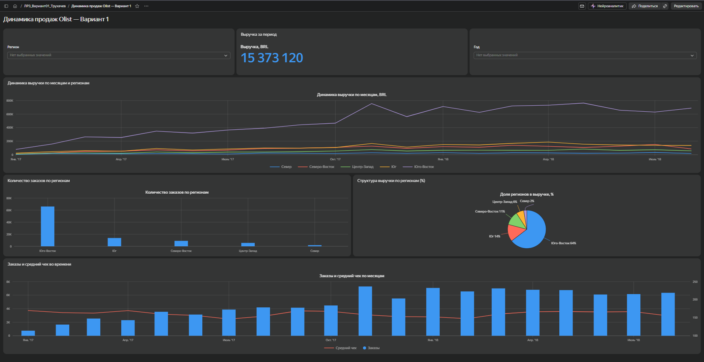

# ЛР-3. Аналитический дашборд для бизнес-кейса — вариант 1

**Студент:** Трухачев Н.А. · **группа:** БД-251м
**Бизнес-кейс:** Динамика выручки и заказов

## Цель работы
Как меняются выручка (GMV), число заказов и средний чек по месяцам и макрорегионам? Есть ли устойчивый рост?

## Исследуемые метрики
- **Средний чек** = `SUM([gmv]) / SUM([orders])`

## Архитектура решения
Kaggle (Olist, 9 CSV) → Python (`urllib`, `pandas`) → SQLite: RAW → STAGING → CORE → витрина `dm_v01_sales_monthly` → CSV → Yandex DataLens.

## Технологический стек
Python 3.13.18, pandas 2.2.3, SQLite 3.45.1, Google Colab / Jupyter, Yandex DataLens.

## Схема данных
Слои: `raw_*` (9 таблиц) → `stg_*` (типизация, очистка) → `core_order`, `core_item`, `dim_state` → `dm_v01_sales_monthly` (VIEW).
<!-- вставьте скриншот или ER-диаграмму: img/er.png -->

## SQL витрины
```sql
CREATE VIEW dm_v01_sales_monthly AS
SELECT purchase_month                                          AS month,
       purchase_year                                           AS year,
       region,
       customer_state                                          AS state,
       COUNT(DISTINCT order_id)                                AS orders,
       ROUND(SUM(order_value), 2)                              AS gmv,
       SUM(items_cnt)                                          AS items,
       COUNT(DISTINCT customer_unique_id)                      AS customers
FROM core_order
WHERE order_status = 'delivered'
  AND purchase_month BETWEEN '2017-01-01' AND '2018-08-01'
GROUP BY purchase_month, purchase_year, region, customer_state
ORDER BY purchase_month, customer_state
```

## Контрольные значения
| Вопрос | Ответ |
|---|---|
| Месяц с максимальной выручкой (YYYY-MM-01) | 2017-11-01 |
| Рост GMV за янв–авг 2018 к янв–авг 2017, % | 143.4 |

## Дашборд DataLens
Ссылка: https://datalens.yandex/2es7ggqxj5aul?_share_link=public

| № | Тип | Название |
|---|---|---|
| 1 | Индикатор | Выручка за период |
| 2 | Линейная диаграмма | Выручка по месяцам |
| 3 | Столбчатая диаграмма | Заказы по регионам |
| 4 | Круговая диаграмма | Доля регионов в выручке |
| 5 | Комбинированная диаграмма | Заказы и средний чек |



## Выводы и бизнес-рекомендации

*   **Устойчивый рост бизнеса:** За период с января по август 2018 года GMV вырос на **+143,4%** по сравнению с аналогичным периодом 2017 года. Число заказов также выросло кратно (с ~750 заказов в январе 2017 до ~7000 в пиковые месяцы 2018). Бизнес находится в фазе активного масштабирования.
*   **Сезонность и пики продаж:** Максимальная выручка зафиксирована в **ноябре 2017 года** (Black Friday). Однако в этот же месяц наблюдается заметное снижение среднего чека (с ~170 BRL до ~150 BRL) из-за массовых распродаж и скидок. Бизнесу стоит заранее готовить логистику и склад к ноябрьским пикам.
*   **Географическая концентрация (Риск):** Наблюдается сильная зависимость от региона Юго-Восток, который дает **64% всей выручки** (главным образом за счет штата Сан-Паулу — 5,77 млн BRL). Рекомендация: для снижения рисков и дальнейшего роста стоит инвестировать в маркетинг и привлекать продавцов в регионах Север и Центр-Запад, где доля выручки составляет всего 2% и 6% соответственно.


